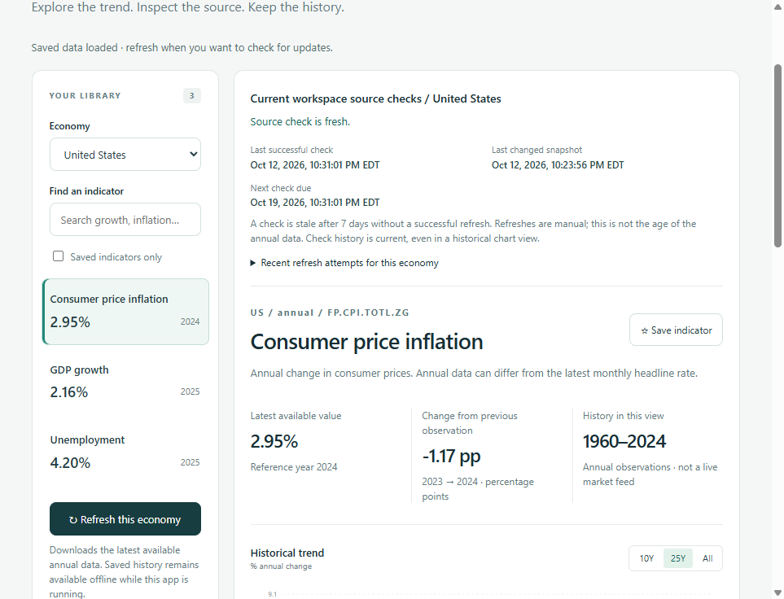
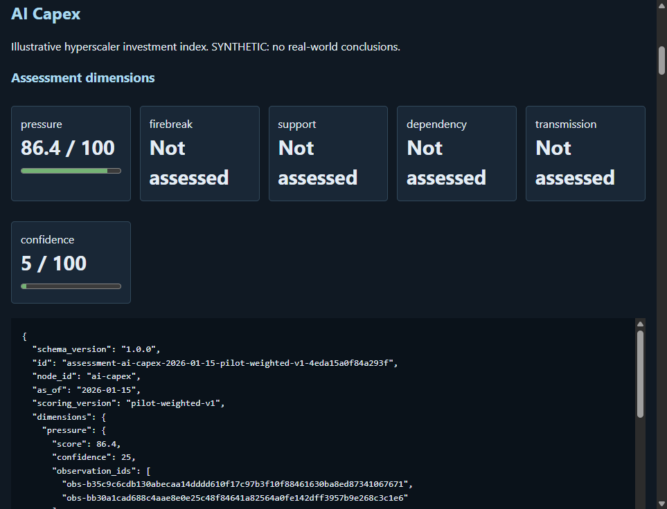

# DominoGraph
Open-source economic intelligence platform that maps global financial, policy, market, and real-economy dependencies into a traceable graph of risks, supports, firebreaks, hypotheses, and transmission paths.

**Current application baseline: 0.2.0 (release preparation).** What runs today is
a local World Bank indicator explorer and a separate synthetic Memory & Compute
dependency pilot. It is not a validated causal model, forecasting platform, or
production multi-user service. Runtime AI, authenticated review, scheduled ingestion,
and empirically calibrated scenarios are planned, not implemented.

## Quick start

Requires Python 3.11 or newer and a source checkout. Run from the repository root.
These paths install the local application and test dependencies; they do not
automatically import indicators or seed synthetic records.

### POSIX shell

```sh
python -m venv .venv
. .venv/bin/activate
python -m pip install -e '.[test]'
python -m uvicorn api.main:app --host 127.0.0.1 --port 8000
```

### Windows PowerShell

Use the virtual environment's Python directly; no activation or execution-policy
change is required.

```powershell
python -m venv .venv
.\.venv\Scripts\python.exe -m pip install -e '.[test]'
.\.venv\Scripts\python.exe -m uvicorn api.main:app --host 127.0.0.1 --port 8000
```

Open <http://127.0.0.1:8000> for the explorer, `/pilot` for the dependency pilot,
and `/docs` for the API. A new workspace is empty by design. To add real data,
use **Refresh this economy** in the explorer, or run in another terminal:

```sh
# POSIX: activate the same environment in this terminal first.
. .venv/bin/activate
python -m scripts.sync_worldbank --country US
```

```powershell
# Windows PowerShell:
.\.venv\Scripts\python.exe -m scripts.sync_worldbank --country US
```

**Optional synthetic pilot:** run `python -m scripts.seed` in the activated POSIX
environment, or `.\.venv\Scripts\python.exe -m scripts.seed` in PowerShell, then
reload `/pilot`. Seeding is separate from real-data import and is never automatic.

### Docker

Requires Docker with Compose. From the repository root:

```sh
docker compose -f docker/docker-compose.yml up -d --build
docker compose -f docker/docker-compose.yml exec api python -m scripts.sync_worldbank --country US
```

In PowerShell, use `-f docker\docker-compose.yml` for each Compose command.
Open <http://127.0.0.1:8765>. For the optional synthetic dashboard, run:

```sh
docker compose -f docker/docker-compose.yml exec api python -m scripts.seed
```

Stop the service with `docker compose -f docker/docker-compose.yml down`.
Do not add `--volumes`: the database volume retains observations and revisions.
Docker also starts empty; the import and seed commands are explicit.

## Configuration and persistence

- Source-checkout SQLite storage is `data/dominograph.db`, resolved relative to the
  repository, not the terminal's working directory. Docker stores the same database
  at `/app/data/dominograph.db` in its named `pilot-data` volume.
- Observations, raw snapshots, sources, and synthetic records persist in that
  database. Saved indicators are browser local storage, scoped to the URL/origin;
  they are not included in the database volume.
- World Bank import requires network access but no API key. Previously imported
  data remains readable without the source network while the local server is
  running. This is not an offline-installed browser application.
- `.env.example` documents settings. Python commands do not load `.env` automatically.
  Set environment variables before starting the application or collector. Keep
  credentials out of source control, screenshots, logs, and command transcripts.
- `FRED_API_KEY` is for the optional collector contract only; a complete FRED
  ingestion/explorer workflow is planned for M1, not available in this release.
- SQLite remains the default. For a source-checkout PostgreSQL setup, install
  `python -m pip install -e '.[postgres]'` using the environment's Python and set
  `DATABASE_URL` to a locally managed `postgresql+psycopg://` connection URL.
  The supplied Compose service explicitly configures SQLite; a shell
  `DATABASE_URL` does not override that service configuration.

For a different Docker host port, set the variable in the shell before Compose:

```sh
export DOMINOGRAPH_PORT=8766
docker compose -f docker/docker-compose.yml up -d --build
```

```powershell
$env:DOMINOGRAPH_PORT = "8766"
docker compose -f docker\docker-compose.yml up -d --build
```

For source-checkout configuration, use `export DATABASE_URL='sqlite:///data/dominograph.db'`
in POSIX or `$env:DATABASE_URL = "sqlite:///data/dominograph.db"` in PowerShell.
The API binds to loopback and is intended for a single local workspace. Docker
does not make it safe for public multi-tenant deployment. File-backed SQLite
backup/restore is described below; general versioned migrations and PostgreSQL
recovery automation remain M1 requirements. See the [security policy](SECURITY.md).

### SQLite backup and restore

Use the workspace CLI rather than copying a live database file. It uses SQLite's
online backup API, including committed WAL changes while excluding uncommitted
transactions. The backup is a standalone SQLite file containing canonical records,
raw snapshots, source metadata, provenance links, synthetic records, and ingestion
history. Browser-local saved indicators, environment variables, credentials, and
application code are **not** included.

Create a consistent backup of the workspace selected by `DATABASE_URL` (or the
normal repository-relative default). Choose a new filename for every backup:

```powershell
New-Item -ItemType Directory -Force .\data\backups | Out-Null
.\.venv\Scripts\python.exe -m scripts.workspace backup --output .\data\backups\workspace.db
```

```sh
mkdir -p data/backups
python -m scripts.workspace backup --output data/backups/workspace.db
```

To recover, restore to a **new** database path. Restore does not change
`DATABASE_URL`, replace your current workspace, or modify the backup:

```powershell
.\.venv\Scripts\python.exe -m scripts.workspace restore --backup .\data\backups\workspace.db --output .\data\restored.db
# Stop your existing application before switching its configured database.
$env:DATABASE_URL = "sqlite:///data/restored.db"
.\.venv\Scripts\python.exe -m uvicorn api.main:app --host 127.0.0.1 --port 8000
```

```sh
python -m scripts.workspace restore --backup data/backups/workspace.db --output data/restored.db
# Stop your existing application before switching its configured database.
export DATABASE_URL='sqlite:///data/restored.db'
python -m uvicorn api.main:app --host 127.0.0.1 --port 8000
```

Before switching, confirm the JSON result reports `restored` and compare its
`content_sha256` with the backup command's result. This checksum covers the exact
stored canonical payloads, reference links, and run records, not SQLite file bytes
or schema/index layout. Check the restored explorer, source evidence, historical
cutoffs, and refresh history. Keep the original database until recovery is accepted;
switching back to its old URL provides rollback without replacing either file.
Keep the same host and port as your normal startup if you want to reuse existing
browser-local indicator preferences; a different origin has separate browser storage.

Restore validates SQLite integrity and canonical table definitions, including types,
defaults, nullability, primary/foreign keys, uniqueness, and CHECK constraints.
It also validates canonical record schemas and semantics, exact provenance references, and run outcomes/
chronology. It validates a temporary copy before and after the existing additive
initialization. Legacy databases gain missing indexes, immutable-record guards,
and an empty run-history table without rewriting payloads or inventing checks.
Interrupted attempts remain incomplete; restoring does not retry collection.
Supported legacy differences are a missing run-history table and missing
initialization-repairable indexes/triggers, not weakened existing table constraints.
SQL whitespace and keyword case may differ; string literals and the canonical
table declarations must otherwise match. Unrecognized custom definitions are
rejected rather than treated as safe upgrades.

Both operations refuse existing destination files, including aliases/symlinks,
and existing SQLite sidecars. They publish only a validated completed file and
remove temporary files on handled failures. The destination directory must already
exist and support hard links, such as NTFS or standard local Linux filesystems;
unsupported storage fails rather than falling back to an unsafe replacement.
Snapshot copying has a 30-second deadline; if the workspace is too busy, retry
after pausing writes. Validation of large backups can take longer.

Only file-backed SQLite URLs without query parameters are supported. In-memory
SQLite and PostgreSQL are explicitly rejected by backup; use database-native
PostgreSQL recovery tooling separately. Restore rejects unknown layouts, record
versions, and malformed backups instead of guessing an upgrade. This is tested
additive upgrade support, not a general versioned migration framework.

Paths supplied to `--backup` and `--output` are relative to the terminal's working
directory; configured relative SQLite database URLs remain repository-relative.
Keep backups private and outside source control. `data/backups/` is ignored, but
other output locations are not automatically protected. Copy completed backups
to separate protected storage; a snapshot on the same disk is not disaster recovery.

#### Docker recovery

Inside the service, use the same commands against its configured SQLite volume:

```sh
docker compose -f docker/docker-compose.yml exec api mkdir -p /app/data/backups
docker compose -f docker/docker-compose.yml exec api python -m scripts.workspace backup --output /app/data/backups/workspace.db
docker compose -f docker/docker-compose.yml exec api python -m scripts.workspace restore --backup /app/data/backups/workspace.db --output /app/data/restored.db
```

To copy the completed backup out, first create the host `data/backups` directory
using the appropriate command above, then run:

```sh
docker compose -f docker/docker-compose.yml cp api:/app/data/backups/workspace.db ./data/backups/workspace.db
```

For Docker activation, stop the service without removing its volume, explicitly
change the service's `DATABASE_URL` to `sqlite:////app/data/restored.db` in your
Compose configuration or override, and restart it. A shell `DATABASE_URL` alone
does not override the supplied Compose environment. Do not rename a backup over
the live database or remove the original database/volume as part of recovery.

## Local indicator explorer

The home page is a working economic indicator library with search, saved indicators,
annual charts, source inspection and historical download cutoffs. Refresh downloads
GDP growth, consumer-price inflation and modeled unemployment from World Bank WDI.
United States, Canada, United Kingdom, Germany and Japan are supported. No API key
is required. Data persists locally and remains readable when the source is offline.

Each series retains raw snapshots, revisions and attribution. Original publication
dates are unknown where the source does not supply them; download history is not an
original-release archive. Imported metrics have no invented pressure-scoring rules.
Saved indicator preferences live in browser storage.

Use **Refresh this economy** to add or update the selected economy. Refresh is
explicit and atomic: failed downloads preserve existing data. The named SQL
database volume survives container recreation; do not remove it when upgrading.

### Source checks and refresh history

Browser refreshes and `scripts.sync_worldbank` now retain country-scoped attempts
in the database, including start/finish times, outcome, checked-series count,
accepted observation/snapshot counts, and sanitized errors. The explorer shows
current check status and the ten most recent attempts for the selected economy,
even when its first import failed and no indicators exist yet.

- **Last successful check** advances after a successful refresh, even if the
  downloaded content is unchanged.
- **Last changed snapshot** advances only when a different source response is
  retained for that economy. It does not assert that economic values changed.
- A check is **stale at seven days** without a successful refresh. This is a
  manual workspace-check policy, not a weekly World Bank publication cadence,
  an assessment of the age of annual observations, or an automatic schedule.
  Status is recalculated when the app loads or requests updated workspace data.
- Failed refreshes remain visible after restart and do not reset the previous
  successful check or alter accepted observations. A fresh check can coexist
  with a later failed attempt; both states are shown.
- Legacy downloads without run records are labeled as having no recorded
  successful check. No check history is invented from download timestamps.
- An attempt without a recorded finish remains explicitly incomplete: it may
  be running or interrupted. It is not automatically reclassified as success
  or failure, and no automatic recovery/retry worker is implied.

For API inspection, use `/api/connectors/worldbank/runs?country=US&limit=20&offset=0`.
`country` is optional; `limit` is 1-100 and `offset` is nonnegative. The response
contains `runs`, `limit`, `offset`, and `has_more`. Catalog `refreshes` and detail
`refresh` describe the **current economy-wide** World Bank check, independently of
a chart's historical cutoff; they do not determine observation availability.

Initialization adds the operational `ingestion_runs` table to existing databases
without rewriting canonical records. Successful data and run completion commit
together; a failed attempt records zero accepted additions. SQLite recovery is
documented above. General migration management, source-neutral freshness policies, and scheduled
execution remain open M1/later requirements.



Screenshot: live U.S. World Bank annual data with the manual source-check status
verified for the first M1 increment.
Values and latest reference years can change; this is not a live market feed.

Source definitions and licenses:
[GDP growth](https://data.worldbank.org/indicator/NY.GDP.MKTP.KD.ZG),
[inflation](https://data.worldbank.org/indicator/FP.CPI.TOTL.ZG),
[modeled unemployment](https://data.worldbank.org/indicator/SL.UEM.TOTL.ZS).
The World Bank and underlying providers are credited in the app.

## Synthetic dependency pilot

The Memory & Compute pilot provides a source registry, immutable observations,
versioned scoring, explicit evidence and counter-evidence, hypotheses, dependency
inspection, and an illustrative scenario runner.

**The bundled Memory & Compute fixture is synthetic.** It demonstrates the plumbing, not
the state of markets, institutional intent, documented coordination, or predictive
accuracy. Do not use the sample assessments to make financial decisions.

Only **illustrative pressure** has scoring inputs. Firebreak, Support, Dependency,
and Transmission remain unmeasured (`null`, shown as "Not assessed"), not zero.
Confidence describes evidence coverage, not predictive accuracy.



Screenshot: invented bundled observations and uncertain relationships, not actual
market conditions. The graph viewer supports dependency inspection, not empirical
validation.

The dashboard intentionally uses browser-native HTML/CSS/JavaScript: no vendor AI
dependency, frontend build pipeline, or dedicated graph database is necessary to
prove the pilot. React, analytical Parquet storage, PostgreSQL adoption, and a
dedicated graph database are need-driven options, not prerequisites for the next
release. See [the development roadmap](docs/development-roadmap.md) for the staged plan.

## Development checks

In an activated POSIX environment:

```sh
python -m scripts.export --check
python -m unittest discover -s tests -v
```

In PowerShell:

```powershell
.\.venv\Scripts\python.exe -m scripts.export --check
.\.venv\Scripts\python.exe -m unittest discover -s tests -v
```

`scripts.export` generates canonical JSON schemas; it is not an observation/data
export tool. Data export is a planned M1 capability.

## Inspect, rather than trust

Select a domino to see Pressure, Firebreak, Support, Dependency, Transmission,
and Confidence independently. Inspect metric vintages, upstream/downstream
mechanisms, intervention records, hypotheses, and counter-evidence. Trace buttons
resolve:

```text
Assessment → Node / Metric / Relationship → Observation / Evidence → Source
```

Relationships have mechanisms and explicit evidence states. Confidence is not a
causal coefficient. Scenarios are conditional illustrations, not forecasts.
Institutional statements remain separate from observed economic outcomes.
Unreviewed model outputs are proposals, not published causal findings.

## Project guide

- [Architecture](docs/architecture/overview.md) and [canonical model](docs/architecture/data-model.md)
- [Evidence](docs/methodology/evidence-model.md), [scoring](docs/methodology/scoring.md), and [scenarios](docs/methodology/scenario-modeling.md)
- [Contribution guide](CONTRIBUTING.md), [security](SECURITY.md), and [code of conduct](CODE_OF_CONDUCT.md)
- [Development roadmap and AI involvement](docs/development-roadmap.md)
- [Next-priority requirements and definitions of done](docs/development-roadmap.md#next-priority-milestone-requirements-and-definitions-of-done)
- [Milestone overview and initial issue backlog](ROADMAP.md) and [changelog](CHANGELOG.md)

Software is MIT licensed. Data licensing is independent: only synthetic examples
are distributed here. A public API or accessible document does not automatically
grant redistribution rights.
